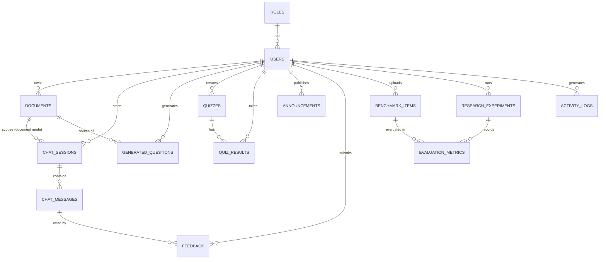
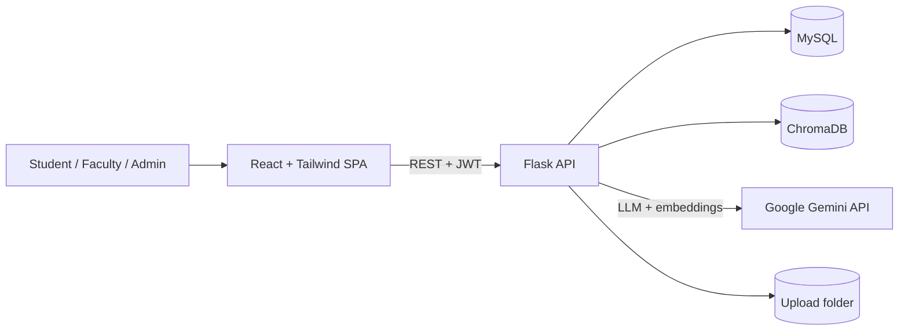
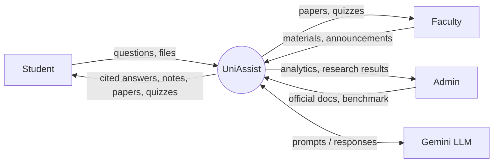
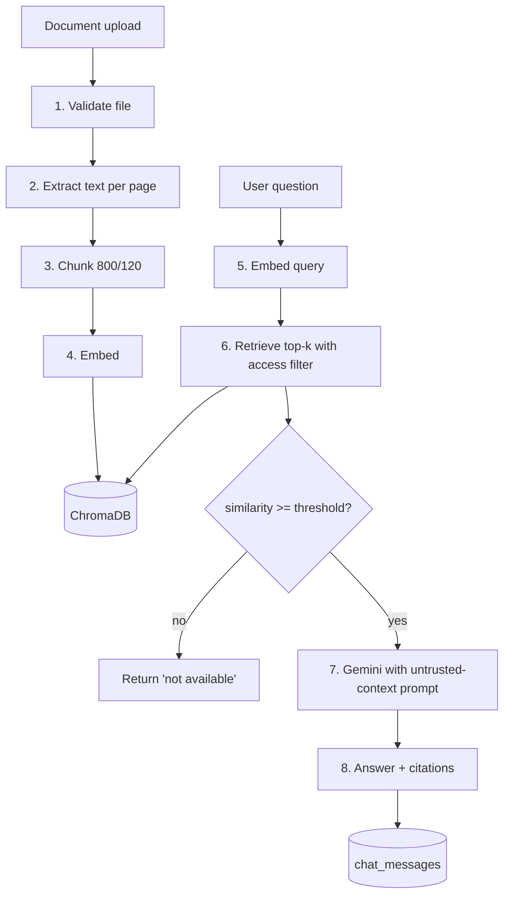
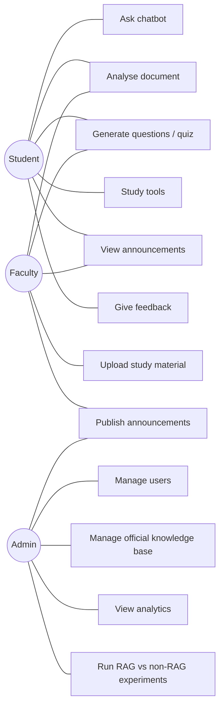
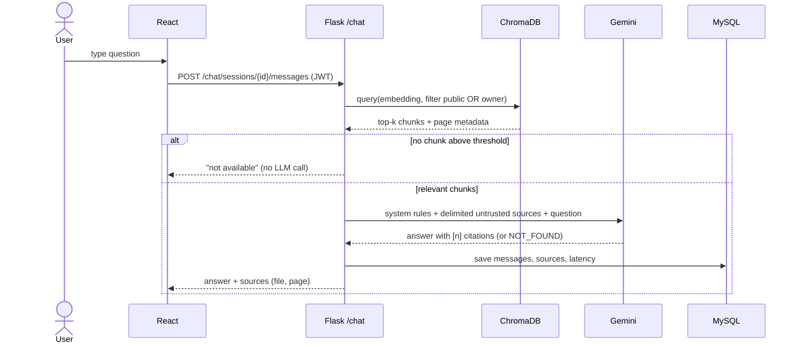
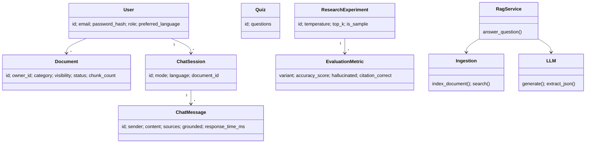

# Diagrams (Mermaid)
Paste any block into https://mermaid.live or view in VS Code/GitHub to render, then export as image for the report.

## ER diagram

## System architecture

## DFD level 0

## DFD level 1 (RAG)

## Use case diagram

## Sequence: RAG question answering

## Class diagram (backend models and services)

